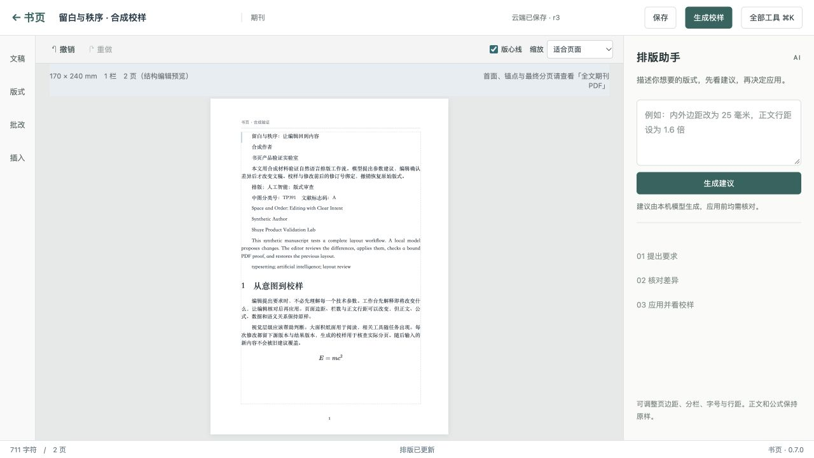
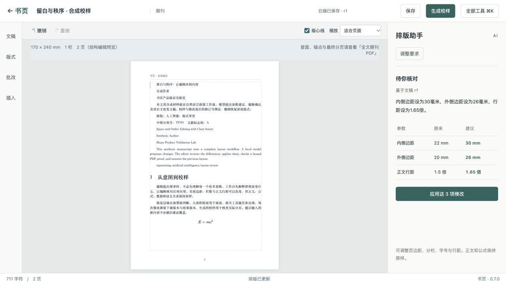

# AI 排版工作台

工作台把纸面留在中心：56 px 顶栏、文稿/版式/批改/插入入口、上下文工具和排版助手。完整工具集中到“全部工具”（Ctrl/⌘K）；原来的功能按钮仍调用原处理流程。属性与大纲按需展开。800 px 以下助手使用可收起侧面板，避免挤压纸面；Esc 可收起，缩放默认适合页面。

实测 1280×720 窗口：默认 10 个按钮（含禁用的重做），顶栏 56 px，画布区域 924×636，占窗口 63.8%。656×977 窄窗口无水平溢出；助手收起时画布宽 606 px。画布比例指工作区，不是纸张墨迹比例。



## 一条可验证的闭环

1. 打开已保存工程，描述版式要求。有本地修改时按钮明确显示“保存并生成建议”。
2. 本机模型返回建议。服务端校验白名单、数值范围、组合几何和源修订；编辑器展示逐项前后值。此时工程没有改变。
3. 编辑点击“应用这 N 项修改”，服务端用保存的建议原子提交。客户端不能另传修改操作；过期、重复或其他用户的建议被拒绝。
4. 期刊工程点击“生成校样”，生成与当前修订绑定的真实 PDF 和检查报告。干净工程不会为了生成 PDF 额外增加修订；异步期间有新编辑时拒绝交付旧校样。
5. “撤销本次修改”恢复原始文稿并生成新修订。有后续修改时禁止覆盖，须重新审查历史版本。

建议生成后自动收起输入区，使差异和操作按钮可见。“调整要求”可再次编辑。刷新页面会取回最后一份建议及其处理状态。提议、应用和撤销在服务器上留下独立记录，浏览器不保存模型密钥。



## 配置

助手默认关闭，不会自动安装或下载模型。在独立服务器的现有私有 JSON 配置中增加：

```json
{
  "assistant": {
    "url": "http://127.0.0.1:11434",
    "model": "qwen3-vl:4b-instruct",
    "timeoutMs": 90000
  }
}
```

`model` 必须是该 Ollama 实例已经安装的完整模型名；示例不是所有机器都具备的默认依赖。仅允许明确的 `http://127.0.0.1:<port>` 根地址，禁止重定向。开始/结束均检查 `/api/tags` 的模型摘要；调用 `/api/chat` 的 [JSON schema 输出](https://docs.ollama.com/capabilities/structured-outputs)并拒绝不完整响应。

只有服务器配置和用户指令、允许的数值版式参数、文稿类型与组件数量参与推理。标题、页眉页脚、正文、公式及图片均不进入模型上下文。用户在指令中主动输入的内容仍会传给本机模型。模型只能提出页面宽高、四边距、栏数、栏距、字号和行距；不能返回正文编辑、文件路径、脚本或任意 MCP 命令。

`get_layout_assistant.enabled` 表示服务器已配置该能力，不表示模型当前健康。未安装模型、超时、响应过大、非法参数、几何失败均保留失败状态，不写文稿。全局最多一个推理任务，响应上限 128 KiB，超时最多 120 秒，最多保留 1000 份建议。到达上限返回明确错误；此版本不提供自动删除，管理员须按自己的保留策略备份并维护私有目录。

六个新增工具：`get_layout_assistant`、`start_layout_plan`、`get_layout_plan`、`cancel_layout_plan`、`apply_layout_plan`、`undo_layout_plan`。通过现有身份隔离 HTTP/MCP 入口访问；应用和撤销都必须携带 `expectedRevision`。运行中重启会将未完成建议标为失败，既有建议和处理记录保留。

## 验收

本轮 188 项 Node 回归全部通过，独立服务器构建和 Workers 构建通过。常规回归：在 `web/` 运行 `npm test`、`npm run build` 和 `node standalone/build.mjs`。助手单元测试的模型服务是 HTTP 测试替身，不能冒充真实模型验收。

另有显式开启的实际验收脚本，要求本机独立服务器已配置 `assistant` 与期刊 Python/XeLaTeX 引擎，并通过环境变量提供既有测试账号密码：

```sh
TEST_ORIGIN=http://127.0.0.1:8789 \
TEST_OUTPUT=/absolute/path/to/new-evidence-directory \
node scripts/assistant-acceptance.mjs
```

提前在当前 shell 设置 `TEST_PASSWORD`，不要写入脚本、Git 或报告。脚本创建两份全合成工程，验证真实模型建议、确认前零写入、重复应用拒绝、应用后正文/公式/表格不变、实际 PDF、撤销后完整工程相等，并保存源文稿、模型身份、修订、校样和检查报告。`TEST_PROJECT_PREFIX` 可指定一次性前缀，不能覆盖已有项目。脚本不自动做逐页视觉验收或声称印刷批准；须另行渲染并逐页核对。

2026-10-26 本机实测：Qwen3-VL 4B instruct（模型 SHA-256 `84f7ed8042fa7cdbd902f7dcb7d0370e032095047cc3244179f263b77b5bc318`）将合成稿内边距 22→30 mm、外边距 20→26 mm、行距 1.5→1.65 倍；r1→r2→r3，三份 PDF 均为 1 页。修改后 PDF 正文边界确实变化；撤销前后 300 dpi 页面像素完全相同，字体均嵌入，文本内容不变。浏览器也实际完成生成、应用、下载校样、刷新取回建议和撤销。该合成样本不是复杂稿件覆盖率或模型准确率评估。

## 当前边界

- 这是版式参数闭环，尚不做自动内容编辑、首面角色判断、逐字改稿或自由版面规划。自由版面继续使用精确工具。
- 页面内的期刊预览仍是结构编辑预览，可能与 XeLaTeX 的最终页数不同。PDF 检查报告保留 `INCOMPLETE` 和未检事项；下载成功不表示可正式发印。
- 笔迹复核若已安装，会归入“批改”工具组。此改动没有新增手写识别、照片与源稿绑定或自动执行批改；没有原稿的网络示例也不能用于证明源稿绑定。
- 当前验证为本机环境，未部署到维护者站点。Ollama 和 XeLaTeX 的资源占用、生产容量及复杂版式效果需要目标部署单独验证。
