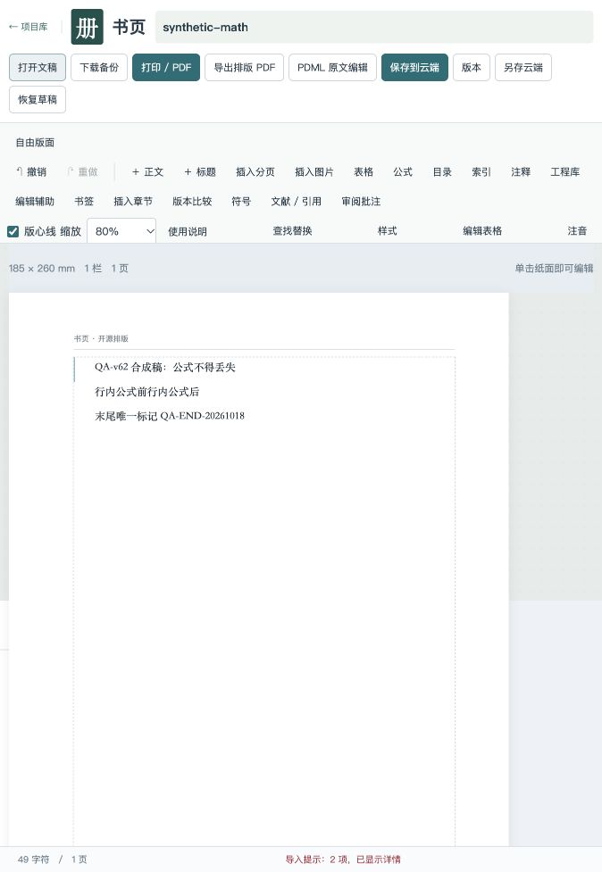
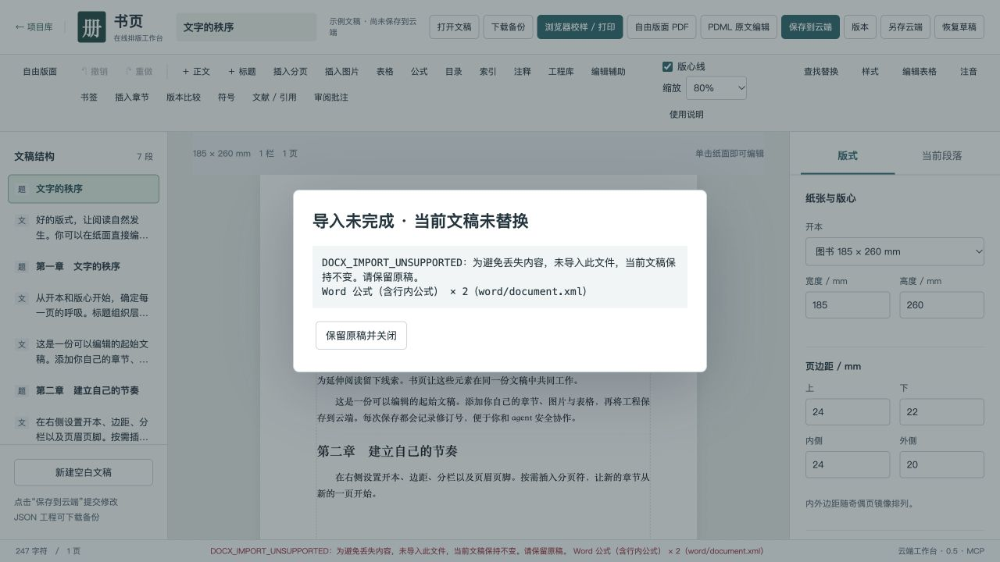
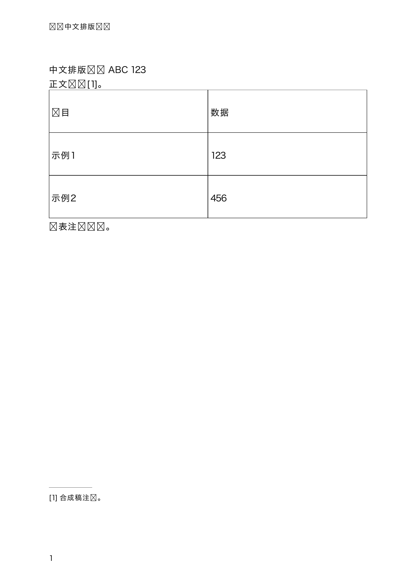
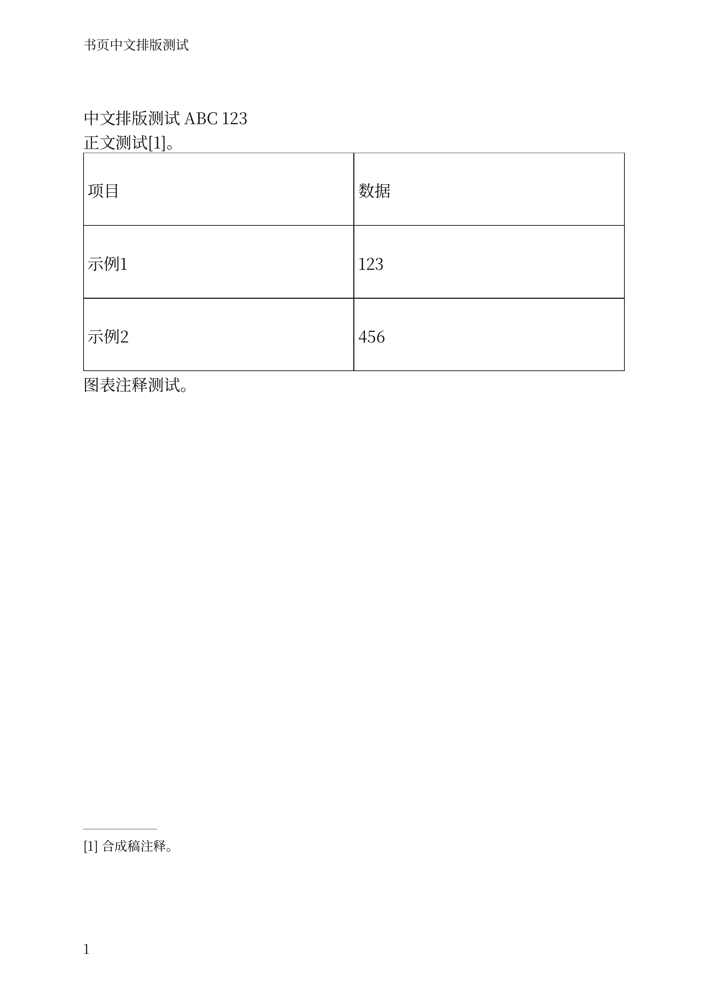

# 书页 DEMO 实测与生产风险修复 · 2026-10-18

**结论：基础在线编辑与 MCP 协作可以验证；中文学术期刊的完整收费交付链路尚未成立。** 本轮修复静默丢稿、错误 PDF 输出与异步保存覆盖，不能把这些保护措施写成复杂稿件支持完成。线上尚未部署本 PR。

## 对象与证据边界

- 实测地址：`https://inkq.online/shuye/`，单人工作区。仓库修复基线 `28de01e16c5d3c7b1e362a92f71afa7658074e39`；这不是已核验的线上部署 SHA，部署端未提供身份端点。
- 在真实浏览器操作登录、新建学术模板、DOCX 导入、公式输入、保存、冲突提示、另存、重开和历史恢复；使用同一账号的受认证 HTTP/API 验证 MCP 与 PDF。仅创建合成稿，四个测试项目结束后均已归档，可恢复；未修改原有项目。
- 另在本地候选执行真实来稿的导入边界检查，不上传、不收录稿件内容。该稿检测出 295 个 OMML 数学区、36 个自动编号属性、219 个 Word 域标记及 7 张表内格式问题；原文件 SHA-256 前后一致。**处理在导入前被阻止，未完成该稿的全篇排版。** 域标记数不等于文献条数。
- 本轮没有操作方正飞翔原应用，没有验证同稿同字体的版面等价、印厂打样、完整 PDF/X 合规、千页负载或多用户越权。不能用代码存在、工具数量或测试通过替代这些证据。

## 已发现并修复

| ID / 级别 | 线上或代码证据 | 本 PR 行为 | 验收与剩余限制 |
|---|---|---|---|
| D01 / P0 | 合成 DOCX 的 1 个行内、1 个独立 OMML 公式全部消失；界面只提示重新录入，文稿已经被替换，JSON 备份同样缺公式 | 在替换前扫描主文档与注释；OMML、OLE、浮动锚点、未接受修订、域、自动编号、复杂表格等已知丢失路径明确拒绝；图片缺失或不支持也拒绝 | 浏览器确认保留原 7 个组件；6 项导入回归测试。**这是保护，不是 OMML/MathType 转换实现。** 基础 DOCX 仍需与原稿核对 |
| D02 / P0 | 中文 CFF 字体 PDF 返回 200、`fontsEmbedded:true`；Poppler 实际渲染报字体错误、部分汉字变方框 | 修复固定版本 fontkit 的 FDSelect 边界、重复 FD 映射/局部子程序归属及 CFF 头 offSize；保留禁止子集化字体的原包装 | 同一合成稿、同一 Source Han Serif SC 子集，修复后独立 300 dpi 渲染汉字正常。所有字体家族/阅读器并未穷举 |
| D03 / P0 | 含 9 个正文组件的学术模板切到空白自由版面，服务仍成功输出 1 页空 PDF | 空画布拒绝输出；存在正文/正文注释/文献时默认拒绝遗漏，必须显式确认仅导出自由版面；报告列出范围、修订号、源与 PDF 哈希 | HTTP 正反例通过。正文与 composition 仍是两份独立内容，未实现自动映射；报告永不把本次导出写成发印批准 |
| D04 / P1 | 代码与延迟请求回归复现：首次保存/另存后重新读取可能覆盖请求期间输入；旧轮询可在保存完成后回退基线 | 创建时绑定已存快照而不覆盖编辑器；保存、打开、恢复保护期间输入；写入使旧读取失效；文稿变化立即缓存草稿，缓存异常不阻止打开云项目 | 9 项同步测试包含竞态与冲突；候选浏览器实际从新标签页恢复未提交草稿。原生输入法组合、断电恢复仍未全面验证 |

Word 导入前后（合成稿，图左/上为线上错误；右/下为候选拒绝）：




PDF 实墨对照（均为独立渲染，非网页截图）：




CFF 实现依据 [Adobe CFF 规范](https://adobe-type-tools.github.io/font-tech-notes/pdfs/5176.CFF.pdf)：头部 offSize 取值 1–4，FDSelect 区间按首字形边界归属。修复限于固定依赖 `@pdf-lib/fontkit 1.1.1` 的适配层；升级依赖须重新验证真实 CJK 字体，不能仅保留 mock 测试。

## 仍阻塞中文期刊交付的产品缺口

| ID / 优先级 | 当前证据 | 下一项应交付的结果与验收门 |
|---|---|---|
| D05 / P1 | “学术论文”模板只是 A4 双栏正文，标题也进入栏内；没有期刊首面字段模型 | 建立中英标题、作者/机构、摘要/关键词、DOI、收稿/基金/通讯作者的语义模板；首面跨栏与双栏正文自动衔接，缺必填项时拒绝生成交付包；以编辑批准样页验收 |
| D06 / P1 | 手工 KaTeX 的矩阵、根式、分式、aligned 可渲染并保存恢复；DOCX 公式不支持，composition richBlock 仅 paragraph/table | 接通可追溯的 OMML/MathType 转换与公式对象；公式源码、编号、对象 ID、渲染资产绑定；长公式跨栏/换行、表内上下标要进入最终 PDF，全篇公式逐项守恒 |
| D07 / P1 | 当前自由框是页坐标对象；正文图题是块文字，未发现统一段落锚点、图题组、引用编号的生产模型 | AI 修改段落后图、题、编号和引用一起重排；跨栏图、页顶/页底约束、禁止题图分离可表达；移动锚段后验证全文阅读序、对象数与页码更新 |
| D08 / P1 | PDF 入口需每次提供 ≤10 MB 字体；本次真实中文字体需先在产品外制作子集才可上传；网页使用系统字体，PDF 用上传字体重新排 | 受许可约束的字体资源包、字形覆盖检查、同引擎校样及输出版本绑定；产品内完成字体准备，保存/重开后不重新选字库；实际换行与 PDF 一致 |
| D09 / P2 | 1280 px 宽下部分工具按钮文字竖向折行；窄窗口操作区占据大量高度。多个导出按钮语义接近 | 本 PR 修正按钮折行、区分浏览器校样与自由版面 PDF；后续按“导入→模板→校稿→交付”组织主流程。手机尺寸本次未获得有效视口证据，不列为通过或失败；未完成 WCAG 审计 |
| D10 / P1 验证缺口 | 近期版本恢复与本地重启持久化可测，但不能据此证明生产备份、容量和失败恢复 | 带真实图片/公式的整篇与整期验收；线上备份异机恢复演练、配额边界、并发及重试、任务幂等、可追踪的失败报告。确认客户时限与实际人工校对成本后再承诺 SLA |

**首批收费验收应按订单通过完整门，而不是按按钮数量通过门：** 原稿对象清单 → 语义导入报告 → 已批准期刊模板 → 全文排版 → 内容/公式/图表守恒 → 每页实际 PDF 校稿 → 编辑接受 → 印厂参数与字体许可验证 → 可恢复交付包。当前 D01/D03 的拒绝路径仍会阻断真实稿件，不具备直接承诺“上传 Word 自动交付印刷文件”的依据。

## 方正飞翔对标带来的重点

官方印刷版页面目前列出 V9.0-1794（2026-07-07），说明了 Word/公式导入、批量格式处理、表格框架、中文禁则及编审能力；近期修复也涉及尾注编号、模板样式与表内格式。这些是本项目应按生产样本验收的方向，不能据此宣称我们的能力等价。[官方版本与功能说明](https://www.founderfx.cn/product/1012.jhtml)

本项目优先实现“AI 能表达、执行并验证一次期刊返修”：稳定对象 ID、版本条件、原子修改、明确限制已有基础；下一步需要**版式约束、内容覆盖清单、PDF 页面对照和交付证据**。继续增加低层工具数量本身不会补齐这些环节。既有 [飞翔研究](fx9-research-acceptance.md) 与 [功能矩阵](feixiang-matrix.md) 应和本轮实测一起阅读，历史通过项不等于本轮线上通过。

## 本轮验证清单

| 范围 | 结果 | 证据含义 |
|---|---|---|
| 在线登录、项目新建、模板、保存、另存、重开 | 已执行 | 合成项目可持久化；原有项目不动 |
| MCP tools/list、dryRun、提交、旧修订写入 | 已执行 | 发现 76 工具；dryRun 不增修订，过期写入 HTTP 409；未逐一验收全部 76 工具 |
| 未登录 API/MCP | 已执行 | 带合法 Origin、无会话均 HTTP 401；不做公网压力或密码尝试 |
| 复杂手工公式 + 历史恢复 | 已执行 | r2 公式保存，恢复 r1 为 r3，再恢复 r2 为 r4，公式仍正确 |
| 中文表格、文字流、脚注、母版页眉页码 PDF | 已执行 | 170×240 mm，1 页合成稿；发现并修复 CFF 实墨错误 |
| 候选浏览器导入保护、输出范围、草稿恢复 | 已执行 | 原文保留、范围错误可见、未提交标题从新标签页恢复 |
| 单元与集成测试 | 141/141 通过 | 基线 127/127，增加 14 项有针对性的回归；基线测试未捕获实墨错误 |
| 标准生产构建、standalone 构建 | 通过 | macOS / Node 26.5.0；CI 平台结果以对应提交检查为准 |
| built standalone HTTP 验收 | 通过 | 7 组检查：认证/Origin、MCP、修订、恢复、导出身份、拒绝遗漏/空白、归档恢复 |
| 完整期刊、印厂打样、方正原应用、多用户、负载 | 未完成 | 不用单页样本或历史报告替代 |

当前审阅 PDF 的 SHA-256：`5f58507651ab50e3f2b111ab71f7fe2f1e432cc4a7b624c203e78a24f3c9a27f`；源码内容 SHA-256：`10e402f5eae7fef92a5aeb3b1254f9617f6a3f745f61e53dd1581a88eec5cfdd`。它是字体/表格/脚注回归样本，不是期刊版式成品。重复生成时 PDF 日期元数据可能变化，不能要求字节哈希不变。

## 复现

```sh
cd web
npm ci
npm test
npm run build
node standalone/build.mjs
node scripts/production-acceptance.mjs /absolute/path/to/licensed-cjk-font.otf /absolute/path/to/new-evidence-directory
```

浏览器复测可使用 `tests/fixtures/omml-rejection.docx`（仅合成内容，含行内和独立 OMML）；应看到拒绝原因，当前文稿应保持不变。

验收脚本仅启动 loopback 独立服务器，使用随机本地测试凭据，不读取线上凭据。可用 `QA_PORT` 改端口。它保留测试数据库和 PDF，避免覆盖既有证据。字体需覆盖 `tests/fixtures/journal-proof.json` 的所有字符且适合当前 API 大小限制，仓库不附带用户字体或真实稿件。脚本成功后仍须独立渲染 `proof.pdf` 并逐页查看中文实墨。

旧 PR #1 面向本地 Python 产品，尚未合入当前 Web 主线；本 PR 基于现有 Web 0.5，独立修复上述事故风险，不包含前一 PR 的期刊模板、复杂公式与图文锚定迁移。
