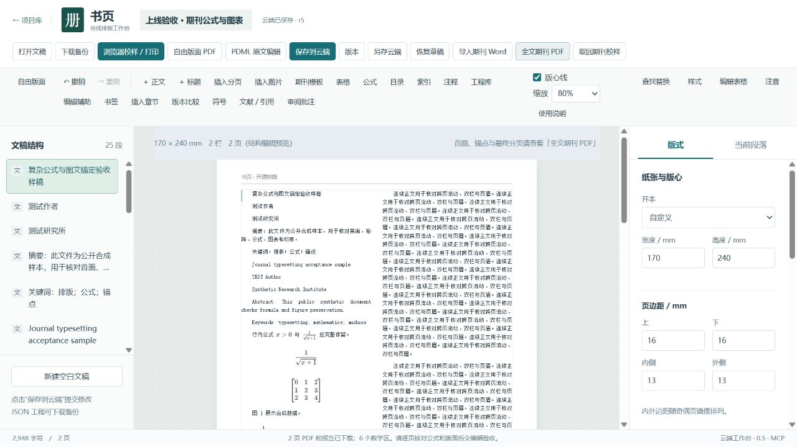

# PR #3 部署与线上验收 · 2026-10-19

地址：[inkq.online/shuye/](https://inkq.online/shuye/)。PR #3 已合并到 main，合并提交 `58526cf6798a0dec04a7457a24f46b7ca606c36e`；`7d3201a` 补齐 Linux 部署/CI 依赖，不改变运行时代码。本站全文期刊引擎已启用，提供 83 个 MCP 工具。

## 发布与数据保护

- 独立发布目录切换，保留上一版运行包及私有配置、数据库、文稿文件的完整备份。
- 最终切换前后 8 条工程索引记录和 19 个原有文稿对象文件一致。验收只修改新建合成工程，结束后 3 个测试工程均已归档，可恢复。
- 发布包 SHA-256：`877d5704b67e10aa7be52da0c994a6679295fc7d6cfcd492aac19823c289c5d3`。
- 服务器 ESM 包 SHA-256：`4a21b92e0c48ab6fade5ff992e7b3ed1f6adf684c4db4addfa8ef0c86ad0d3e1`；导入界面模块摘要也与本地构建一致。界面与 healthz 的既有版本字段仍为 0.5.0，发布身份以上述提交和摘要为准。
- 首次切换的内部健康请求遗漏 Host 头，触发自动回滚。修正为 `Host: inkq.online` 后重新切换成功，以下线上测试均在最终切换后执行。
- Nginx 配置检查通过，域名原首页返回 200；书页 systemd 服务 active/enabled，无自动重启，重启后工程及校样仍可读取。

## 环境与依赖修正

Ubuntu 24.04，Node 22.22，Python 3.12.3，XeTeX/TeX Live 2023。独立 Python 环境安装 pypdf、Pillow、pdfminer.six；测试另安装 pdfplumber。补齐 `texlive-plain-generic`（ulem）和 `latex-cjk-common`（ruby）等包，并将缺失依赖写入 CI 和部署文档。

服务使用原有低权限账号及 systemd 隔离配置。默认中文为 Fandol，不依赖商业字体；没有配置字体的显式方案仍应返回错误。部署后剩余磁盘约 7.9 GB；本次合成验收的服务内存峰值低于 300 MB，不能据此推断大型稿件的容量。

## 验收结果

| 项目 | 结果 |
| --- | --- |
| 服务器引擎回归 | 67 项：66 通过，1 个 macOS 指定 STIX 字体路径测试跳过；由书页账号在可写测试副本中运行 |
| 本地 Web 回归及构建 | 合并前 163 项通过；独立服务器和 Web 生产构建通过 |
| 正式 HTTPS 鉴权 | 本站登录成功；未认证 API 请求返回 401 |
| 能力探针与 MCP | `get_journal_capabilities.enabled=true`；83 个工具；实际编译使用 XeLaTeX/Fandol |
| DOCX → 全文 PDF | 2 页，6 个数学区，2 组图文锚点，29 个源对象全部覆盖；报告没有 error、缺字或越页诊断；字体嵌入 |
| 文件与修订绑定 | PDF SHA-256 与报告一致；默认拒绝过期校样；显式允许旧版时返回 stale=true |
| 编辑保护 | 旧 expectedRevision 写入被拒绝；版本恢复产生新修订并恢复标题 |
| 浏览器 | 正式域名打开工程，点击全文期刊 PDF，页面确认“2 页 PDF 和报告已下载；6 个数学区” |
| PDF 独立渲染 | Poppler 渲染两页，中文、分式、矩阵、图表、双栏及参考文献可见；pdfminer 正确读取中文。pypdf 对该 XeTeX PDF 的中文提取异常，不用于判定文字丢失 |
| 自由版面 CFF 回归 | 通过正式 API 输出一页含中文、表格、注释的 Fandol CFF PDF；Poppler 无字体错误，中文显示正常；摘要一致 |
| 防止空稿与遗漏 | 空白自由版面被拒绝；自由版面遗漏正文默认被拒绝 |
| 重启持久化 | 显式重启服务后，工程 r5 和既有 PDF/报告可读取，摘要不变，期刊引擎仍可用 |

上述结果针对公开合成稿和现有自动回归样本。未声明完整方正原生格式双向兼容、所有真实期刊同版复刻、商业字体穷举或完整 ISO PDF/X 合规；校样报告的 productionReady=false 保持不变。
