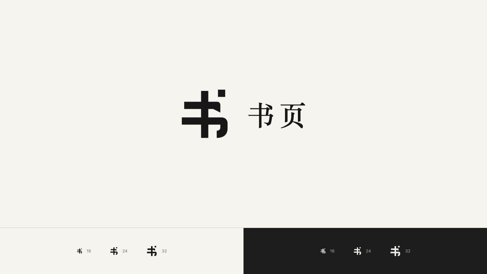
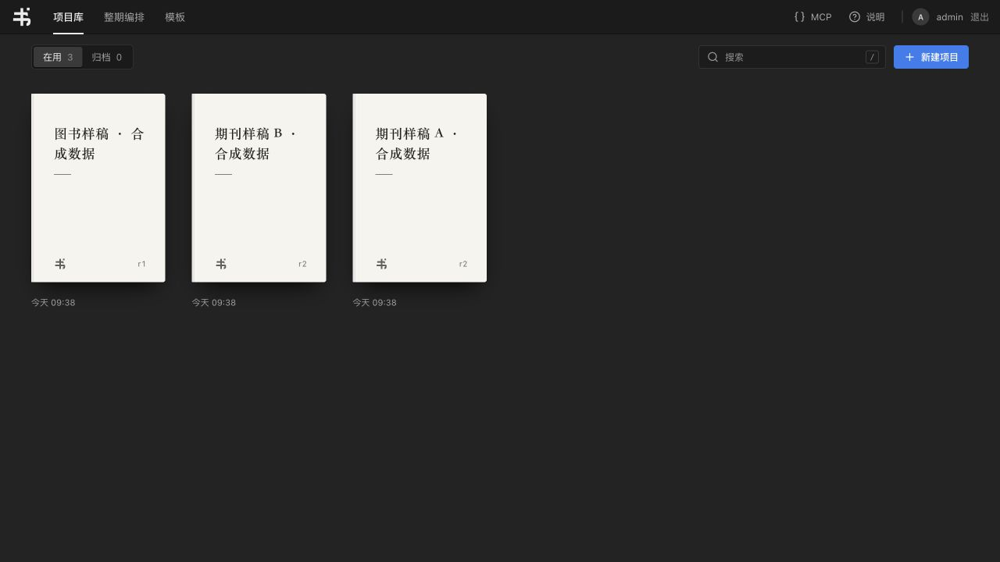
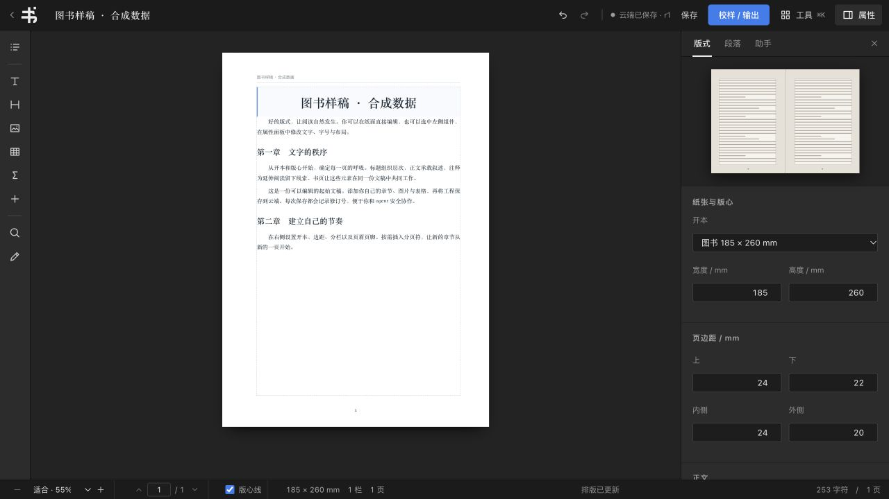
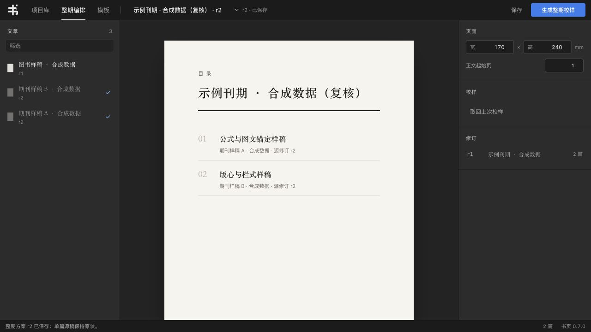

# 书页桌面工作区与品牌标志

项目库、整期编排与编辑器使用统一的深灰工具区、纸色预览和蓝色交互提示。界面面向桌面排版，主要动作围绕稿件、版式和校样组织，不新增移动端布局。

品牌标志以“书”为骨架，保留直竖、右侧钩笔与点画，用单色 SVG 表达。应用栏、封面印记、登录/账号页与编辑器共用 `public/brand/shuye-mark.svg#mark`，favicon 使用相同轮廓和纸白底。图形不依赖字体、脚本或外链。最小尺寸的上横与下横保留 4/48 的间隙。

所有截图均来自独立本地环境的合成示例。

## 对抗性审查与修正

桌面 UI 经 Claude Opus 5.5 独立复核，再由 Codex 检查代码、接入修复并执行以下验证。Logo 为 Codex 设计的原生矢量，已根据审查意见调整小尺寸间隙和钩笔位置。

- 整期方案没有变化时保存不再递增修订，避免让仍对应当前稿件的校样失效；历史预览发生修改时仍创建新修订。
- 校样通过方案 ID、方案修订、源稿修订与文章顺序绑定；过期或不匹配时收起下载和页码。
- 取消等待不会让迟到的启动/轮询结果重写界面。
- 恢复框架版说明与 MCP 页的有序列表编号；加深纸面辅助文字、提亮深色面板标签。
- 封面印记改为继承前景色的 SVG；阻止本页文章拖到目录外输入框时插入题名。
- 交付核对包含新增 logo、状态模块与状态测试，避免只提交已跟踪文件。

## 本机验证

- Web：203 项通过，0 跳过。
- 核心 Node：80 项通过，1 项浏览器分页测试跳过。
- Python：23 项通过，1 项依赖固定 XeLaTeX 路径的发布测试跳过。
- `scripts/check-acceptance.py` 通过账本结构检查；完整产品验收仍为未完成，不代表正式发布批准。
- 独立部署构建与框架构建通过；源码语法及 `git diff --check` 通过。
- 浏览器实测：带前缀独立部署与无前缀框架版的 logo 均正常；返回项目库、新建弹窗取消和焦点恢复、Alt+方向键目录排序可用；连续三次无修改保存维持 r1，真实编辑后保存生成 r2；框架说明页显示 1–5 编号。

## 限制

本机没有可用的 LibreOffice/UNO，未重新完成整期 Word/PDF 生成。原生系统拖拽、Windows 强制颜色模式及 Firefox/Safari 尚未完成实机验证。该 PR 依赖已有 AI 工作台 PR #7；没有改变科学稿件、印刷基线或部署正式站点。
