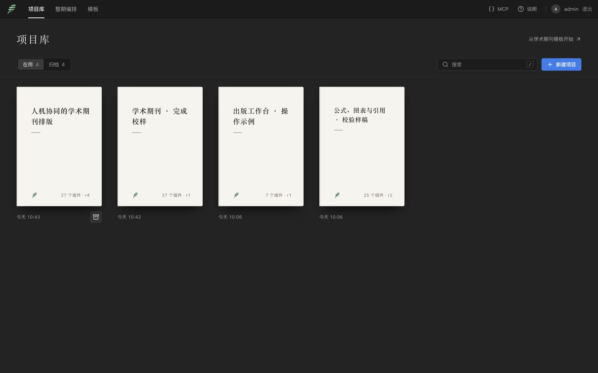
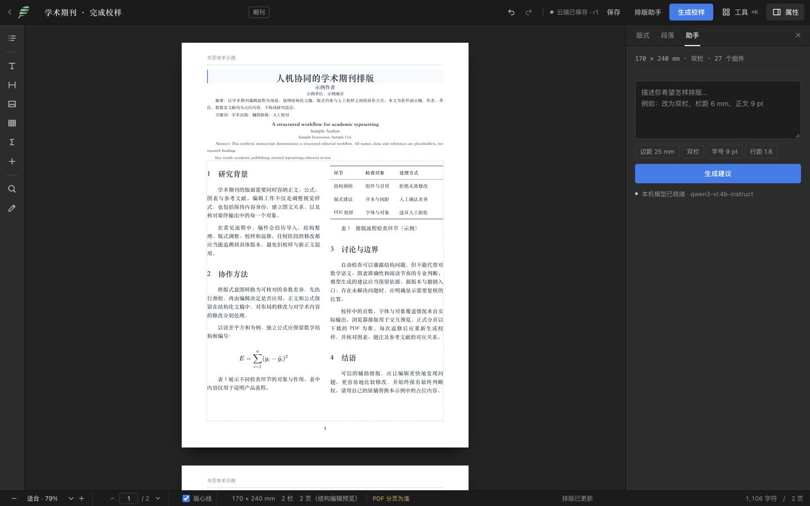
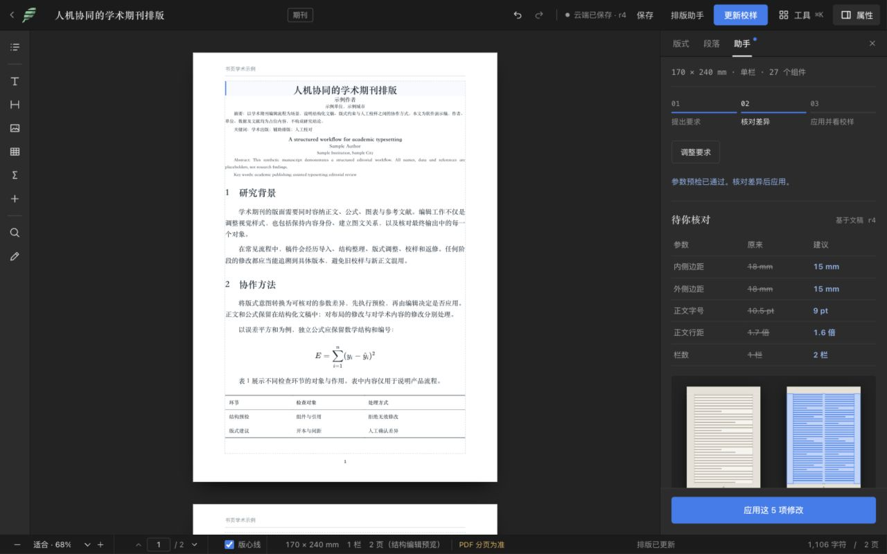
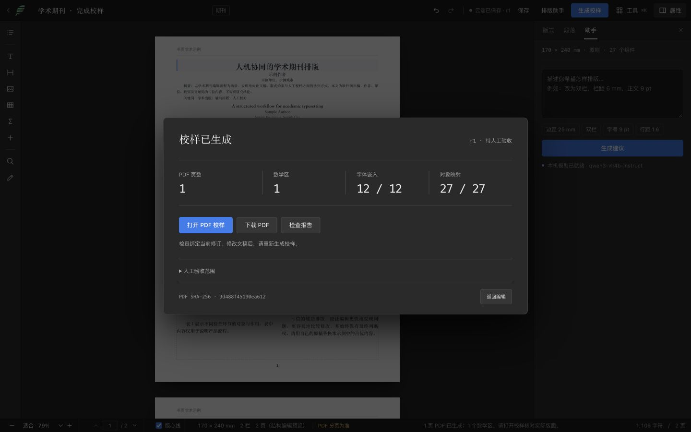

# 学术排版工作流

书页面向需要处理中文学术稿件的编辑。桌面工作区保留中央纸面、左侧结构和右侧属性；学术期刊默认打开排版助手，人工操作与 AI 建议共用同一份结构化工程。

## 从稿件到可检查的校样

1. 在项目库新建“学术期刊”，或使用“导入期刊 Word”。模板含中英文题名、作者、单位、摘要、关键词、编号公式、三线表及参考文献；模板内容全部为演示占位。
2. 在纸面编辑正文，或在属性中调整版式与组件。浏览器对首面角色使用专用字体层级；它仍是结构编辑预览，实际首面通栏、分页和锚点关系以 PDF 为准。
3. 在助手中描述明确要求，或点击“期刊双栏”填入可编辑的参考参数：双栏、栏距 6 毫米、内外边距 15 毫米、字号 9 pt、行距 1.6 倍。它是起点，不代表所有期刊的规范。保存后生成提案，检查每项前后值，再应用。当前已满足的参数不出现在差异中。
4. 生成校样后查看页数、数学区、字体嵌入与对象映射。当前修订已有校样时，顶栏显示“查看校样”，复用现有结果；改稿后显示“更新校样”，保存并生成新结果。打开 PDF 核对真实版面，按需下载 PDF 或报告。下载前再次检查源修订，读取期间继续修改也会阻止交付旧版本。
5. 没有后续修改时，可撤销整份 AI 提案并创建恢复修订；有人工修改时，旧提案和直接撤销会被拒绝，防止覆盖新内容。无变化的 Ctrl/⌘S 不创建新修订。

确认操作固定在建议区底部；失败、取消或撤销后直接展开要求输入，便于继续调整。重复取回同一修订的校样不再启动编译；同一页面的重复生成动作共用一个进行中的请求。模型建议仍需明确确认，版式示意不预测实际页数。

## AI 的职责

内置助手使用已配置的本机模型，把意图转为十种受限版式参数。服务端先检查 schema、几何和源修订，再返回待确认差异；最终由编辑应用。正文、公式和图片不发送给模型，只有用户主动输入的要求、数字参数与结构统计参与推理。模型未就绪、响应不完整、断线和非法建议都应可见且不写入文稿。

更完整的外部 agent 可以通过 MCP 读取结构、逐项编辑与查看实际校样坐标：

| 阶段 | 入口 | 检查点 |
| --- | --- | --- |
| 发现 | `list_projects`、`get_project_context` | 工程、修订、角色缺口、分页章节与能力路线 |
| 定位 | `list_components`、`get_document_schema` | 稳定组件 ID、公式来源、单位与引用 |
| 试排 | `apply_changes` + `dryRun:true` | 原子验证，无持久写入 |
| 应用 | `apply_changes` + `expectedRevision` | 拒绝过期修订和非法组合 |
| 校样 | `get_journal_capabilities`、`start_journal_proof` | 运行环境可用、任务绑定源版本 |
| 复核 | `get_journal_proof_page`、检查报告、PDF | 实际对象位置与逐页人工验收 |
| 恢复 | `restore_version` | 以新修订恢复，保留记录 |

`get_project_context` 省略图片数据、导入报告和长正文；章节按 offset/limit 分页，角色缺口和未绑定题注仅为结构提示。它不判断数学语义、视觉质量或印刷批准。`get_project_status` 只查用户隔离的元数据，编辑器先检查修订变化再获取完整文稿；大图片工程不再每次轮询传输全文。打字时草稿缓存延迟 400 ms 合并写入，离开页面前立即尝试保存。

## 整期与交付边界

整期编排独立保存选稿、顺序与源修订。环境未启用整期引擎时，可以继续编排和保存，生成按钮明确禁用；单篇 XeLaTeX 校样是另一条独立能力。历史源稿更新后，需要重新绑定文章版本并生成校样。

本流程用于专业学术编辑的辅助工作。自动检查通过不等于可发印；全文、公式语义、图表准确性、每页版面、字体许可和印厂条件仍需专业验收。模型能力与真实稿件覆盖率应通过目标语料单独评估，不能由少量合成演示推算。
